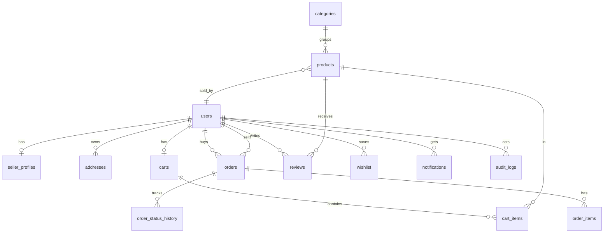

# FarmLink — Database Schema (MongoDB)

Collections: `users, seller_profiles, categories, products, addresses, carts, cart_items, orders, order_items, status_history, reviews, wishlist, notifications, audit_logs` — with unique indexes on `users.email`, `categories.slug`, `orders.order_number`, `(cart_id, product_id)`, `(buyer_id, product_id)` wishlist, and `(order_id, product_id)` reviews.

Money is stored as **integer paise** (never float) and converted to Decimal rupees at the API boundary; quantities are floats; ids are ObjectIds (strings in the API). Stock decrements use an atomic guarded `find_one_and_update` (`available_quantity >= qty`) so concurrent checkouts can't oversell; cancelled/rejected orders restore stock.

Key constraints: unique email, unique (cart,product), unique (buyer,product) wishlist, price/qty checks (`price>=0`, `qty>=0`, `moq>0`, `rating 1..5`), FK cascades (cart/items, orders/items/history), `SET NULL` for product refs in history.

State machine enforced server-side:
`placed → accepted/rejected/cancelled → preparing → ready → dispatched → delivered`, plus `collected` alternative; invalid transitions return 400. Stock decremented in-checkout transaction with row lock; restored on cancel/reject.
