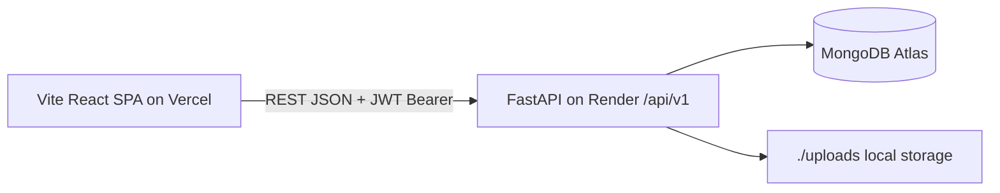

# FarmLink — Project Overview

## Abstract
FarmLink is a full-stack direct farmer-to-buyer agricultural marketplace built as a UI/UX Design subject project with real end-to-end functionality (React + FastAPI + SQLite).

## Problem statement
Multiple intermediaries reduce farmers' earnings and increase consumer prices.

## Existing-system limitations
- Opaque, multi-hop mandi chains; farmers are price-takers.
- No harvest-date / farm-level transparency for buyers.
- Small farmers lack digital storefronts; buyers lack bulk discovery.
- Logistics are ad-hoc; compatible orders are rarely grouped.

## Proposed solution
A role-based marketplace where farmers/FPOs list produce with transparent pricing, buyers discover/order/track, and admins moderate. Plus demand insights (historical totals) and explainable logistics lane-grouping. All "benefit" claims are framed as *intended* benefits.

## Target users & personas
- **Marginal farmer (Meera, 42, Coimbatore):** low digital literacy, needs big buttons, Tamil labels, minimal fields.
- **Restaurant buyer (Arun, 31, Chennai):** compares prices/units, bulk orders, needs invoices/timelines.
- **Admin/moderator:** verifies sellers, suspends bad listings, audits actions.

## User stories (sample)
- As a farmer I can publish a tomato listing with price/stock so buyers can order it.
- As a buyer I can filter by category/price, add to cart, checkout with COD, and track placed→delivered.
- As an admin I can approve a pending seller and suspend an inappropriate listing with an audit trail.

## Functional requirements
Auth + roles, seller onboarding/verification, product CRUD with image upload, search/filter/sort/paginate, cart, multi-seller checkout (one order per seller), order state machine, reviews (completed orders only), wishlist, notifications, dashboards, demand analytics, logistics suggestions, admin moderation, i18n (en/ta).

## Non-functional requirements
Responsive (320px→desktop), WCAG 2.2 AA practices (focus, labels, contrast, no color-only status), debounced search, paginated lists, server-recalculated money (Numeric, never float), transactional stock decrement, CORS allow-list, Argon2 hashing, JWT auth.

## Information architecture
- Public: `/`, `/market`, `/products/:id`, `/login`, `/register`
- Buyer (auth): `/buyer`, `/cart`, `/checkout`, `/orders`, `/orders/:id`, `/profile`, `/notifications`, `/insights`
- Seller: `/seller` (overview/products/orders tabs), `/seller/products/new|edit`, `/onboarding`, `/logistics`
- Admin: `/admin` (overview/users/sellers/products/orders/audit tabs)

## System architecture

## Tech stack
Frontend: React 18, Vite 5, TS, Tailwind 3, React Router 6, TanStack Query 5, Hook Form + Zod, lucide-react, Recharts, Framer Motion, react-hot-toast.
Backend: FastAPI, PyMongo (MongoDB, money as integer paise), Pydantic v2 + pydantic-settings, python-jose JWT, passlib/argon2, pytest + mongomock.

## Future enhancements
HttpOnly-cookie auth + refresh rotation, Postgres + Alembic, object storage (S3/Cloudinary adapter), full Tamil coverage, voice-search opt-in, real payments, driver tracking (explicitly *not* claimed now).
