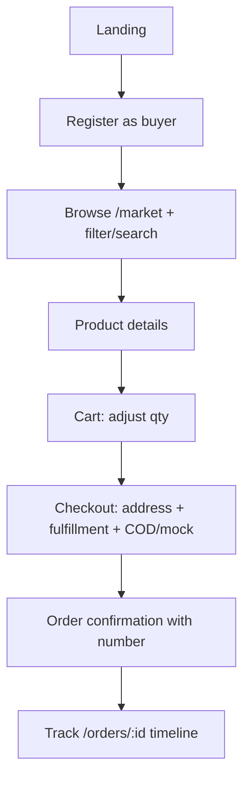
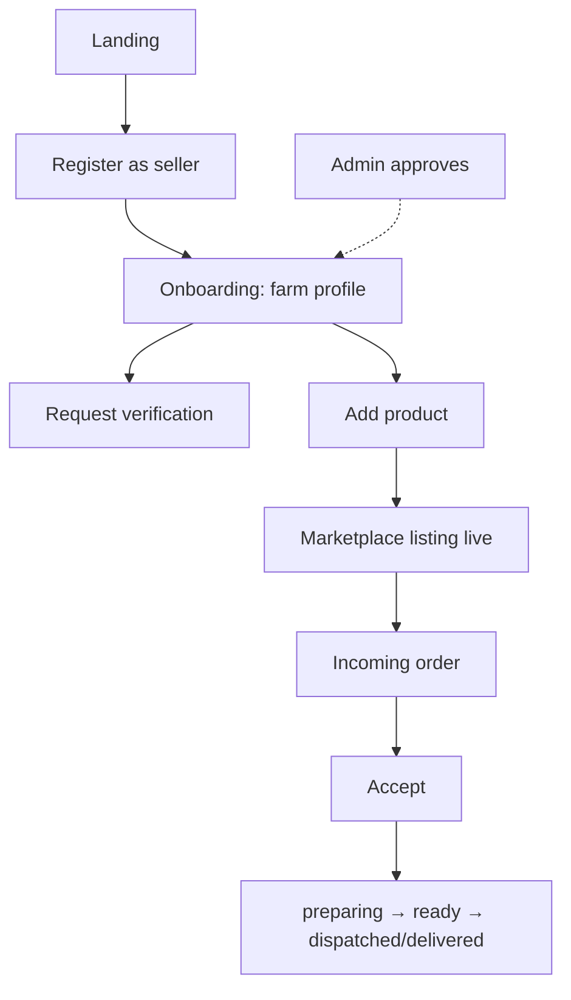
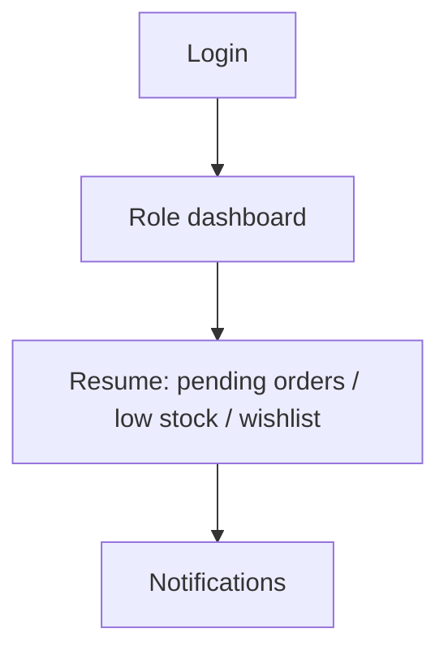

# FarmLink — User Flows

## Flow 1 — Buyer


## Flow 2 — Farmer


## Flow 3 — Administrator
```mermaid
flowchart TD
  LI[Admin login] --> D[/admin dashboard]
  D --> RV[Review pending sellers]
  RV --> AP[Approve/Reject + audit log]
  AP --> MO[Moderate product active/suspended]
  MO --> MN[Monitor orders + audit history]
```

## Flow 4 — Returning user

